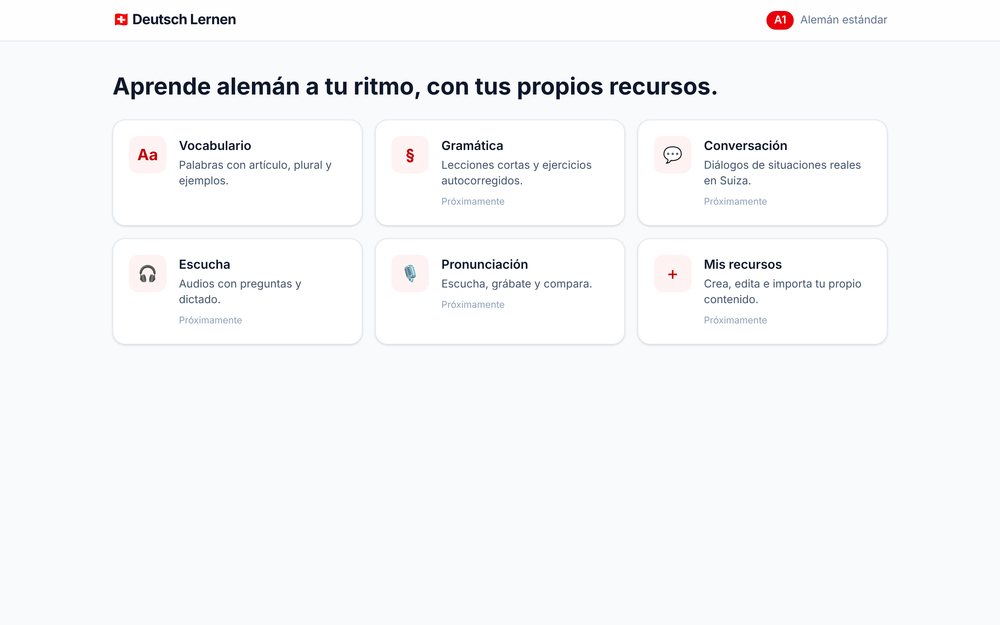
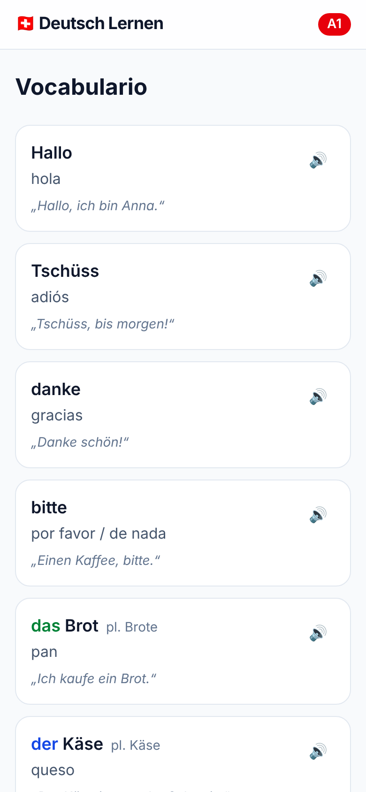

# Deutsch Lernen 🇨🇭

**A self-hosted web app to learn German from A1, where every user owns and extends their learning content.**

Built with **React + TypeScript** and **ASP.NET Core (.NET 10)**. Responsive for mobile and desktop.
Standard German first, designed so Swiss German (Schweizerdeutsch) plugs in later.

[](https://github.com/natan-garcia/deutsch-lernen/actions/workflows/ci.yml)


| Desktop | Mobile |
| --- | --- |
|  |  |

## Why

I moved to Switzerland and need German. Most apps decide what you learn; this one ships a fixed platform and a
**shared, versioned data format**, and lets each person add, edit and import their own words, lessons and
dialogues in their own local instance.

## Features

| Section | Status |
| --- | --- |
| Vocabulary: article colours (der/die/das), plural, examples, text-to-speech | ✅ first version |
| Grammar: short lessons and self-checking exercises | 🔜 |
| Conversation: guided dialogues from Swiss daily life | 🔜 |
| Listening: audio with questions and dictation | 🔜 |
| Pronunciation: listen, record, compare | 🔜 |
| My resources: create, edit, import and export packages | 🔜 |
| Swiss German variant (`gsw-CH`) with fallback to standard German | 🧱 model and API ready |

## Quick start

**With Docker** (nothing else to install):

```bash
docker compose up --build
```

Open http://localhost:8080. Your data lives in the `app-data` Docker volume.

**Without Docker** (Node 22 and .NET 10 SDK):

```bash
# terminal 1: API on http://localhost:5080
cd api/src/DeutschLernen.Api && dotnet run

# terminal 2: web on http://localhost:5173 (proxies /api to the API)
cd web && npm install && npm run dev
```

On first start the API loads the example package from `content/packages` into a local SQLite file.

## Architecture

```
web/  React SPA ──/api──▶  api/  ASP.NET Core Minimal API ──▶ SQLite (your data)
                                   ▲
                       content/    │ seeded once from resource packages
                       schema/  +  packages/a1-starter
```

| Layer | Tech |
| --- | --- |
| Frontend | React 19, Vite, TypeScript, React Router, TanStack Query, Tailwind CSS |
| Speech | Web Speech API behind a `SpeechService` interface |
| Backend | ASP.NET Core Minimal API (.NET 10), EF Core, SQLite |
| Content | JSON Schema (draft 2020-12), versioned resource packages |
| Tests | Vitest + Testing Library, xUnit + WebApplicationFactory |
| Delivery | Docker Compose, GitHub Actions |

Key design choices are documented as ADRs:

1. [React + TypeScript and ASP.NET Core](docs/adr/0001-react-and-dotnet.md)
2. [Local SQLite and content packages](docs/adr/0002-local-sqlite-and-content-packages.md)
3. [Language variants with fallback](docs/adr/0003-language-variants.md)

## Resource format

A package is a folder with a `manifest.json` and one file per resource type:

```json
{
  "id": "a1-velo",
  "level": "A1",
  "variant": "gsw-CH",
  "variantOf": "a1-fahrrad",
  "lemma": "Velo",
  "gender": "n",
  "plural": "Velos",
  "partOfSpeech": "noun",
  "translations": { "es": "bicicleta (suizo)" },
  "example": { "de": "Ich fahre mit dem Velo." },
  "tags": ["transporte"]
}
```

Schemas: [`content/schema`](content/schema). Validate all packages with `cd web && npm run validate:content`.
Keep the source URL and licence of anything you import in `source`; sharing packages with third-party content
depends on that content's licence.

## Development

```bash
cd web && npm test && npm run lint && npm run build
dotnet test api/DeutschLernen.slnx
```

## Roadmap

1. Base: skeleton, schema v1, CI ← **you are here**
2. Vocabulary with spaced repetition + "My resources" (CRUD)
3. Grammar and listening
4. Conversation and pronunciation → **v1.0 (A1 complete)**
5. Structured import (JSON/CSV) and package export
6. Swiss German variant in the UI
7. v1.1: Python microservice for assisted import with a local model

## License

[MIT](LICENSE)
